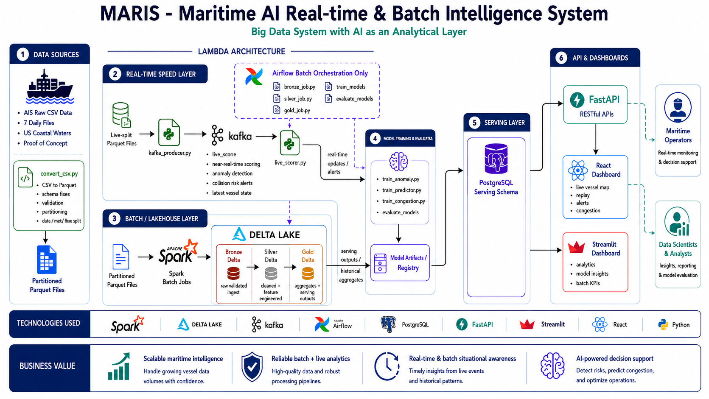

# MARIS – Maritime AI Real-Time & Batch Intelligence System

An end-to-end Big Data platform for processing maritime vessel data through batch and real-time pipelines, enabling vessel monitoring, traffic analytics, data quality management, and AI-assisted maritime risk analysis.


<p align="center">
  
</p>


## 📖 Project Overview

MARIS processes Automatic Identification System (AIS) data to support maritime intelligence and historical analytics. The platform combines real-time data processing with batch ETL workflows, using a lakehouse architecture to organize, transform, and serve vessel traffic data.

The system is designed to support:

- Real-time vessel monitoring
- Historical maritime traffic analytics
- Vessel traffic congestion analysis
- Anomaly detection and collision-risk assessment
- Data quality checks and deduplication
- Structured data storage for analytics
- API-based access to processed data
- KPI reporting and visualization

## 🏗️ System Architecture

MARIS combines two processing paths:

- **Real-Time Pipeline:** Processes incoming vessel data using Apache Kafka and Spark Structured Streaming.
- **Batch Pipeline:** Processes historical data using PySpark, Delta Lake, and Apache Airflow.

Both pipelines support downstream analytics and data serving.

### High-Level Architecture

```text
             AIS Vessel Traffic Data
                       |
                       v
              Data Ingestion
                       |
             +---------+---------+
             |                   |
             v                   v
      Real-Time Pipeline    Batch Pipeline
             |                   |
        Apache Kafka        Apache Spark
             |                   |
   Spark Structured         Delta Lake
       Streaming            Bronze Layer
             |                   |
             |              Silver Layer
             |                   |
             |               Gold Layer
             |                   |
             +---------+---------+
                       |
                       v
               PostgreSQL
              Serving Layer
                       |
                       v
                  FastAPI
                       |
                       v
              Analytics & KPIs
```

*The diagram presents a high-level logical view. Refer to the implementation and screenshots for the exact component connections.*

## 📦 Dataset

The project uses Automatic Identification System (AIS) vessel traffic data.

| Item | Details |
|---|---|
| Data type | Maritime vessel tracking data |
| Source | NOAA MarineCadastre AIS Vessel Traffic |
| Dataset size | 62M+ AIS records processed |
| Input format | CSV and processed data formats |
| Processing modes | Batch and real-time |

**Dataset source:** [NOAA MarineCadastre – Vessel Traffic Data](https://hub.marinecadastre.gov/pages/vesseltraffic)

## 🔄 Data Engineering Pipelines

### 1. Data Ingestion and Preprocessing

The ingestion workflow prepares AIS records for downstream processing.

Key activities include:

- Reading and processing vessel traffic data
- Schema validation and data type handling
- Data cleaning and deduplication
- Preparing structured data for analytical workloads

### 2. Real-Time Processing

The real-time pipeline uses Apache Kafka and Spark Structured Streaming to process vessel data as it arrives.

Key capabilities include:

- Streaming data ingestion
- Real-time vessel data processing
- Vessel-state updates
- Anomaly-related analysis
- Collision-risk assessment

### 3. Batch Processing and Lakehouse

Historical AIS data is processed using PySpark and Delta Lake.

The pipeline follows a Medallion Architecture:

| Layer | Purpose |
|---|---|
| Bronze | Store ingested data |
| Silver | Clean, validate, and transform data |
| Gold | Prepare curated datasets for analytics |

Apache Airflow orchestrates batch processing workflows.

### 4. Data Serving and APIs

PostgreSQL provides structured storage for processed data and analytical outputs.

FastAPI exposes selected data through REST endpoints for downstream applications and analytics.

## 🛠️ Technology Stack

| Category | Technologies |
|---|---|
| Programming | Python, SQL |
| Data Processing | Apache Spark, PySpark, Spark Structured Streaming |
| Streaming | Apache Kafka |
| Lakehouse Storage | Delta Lake |
| Workflow Orchestration | Apache Airflow |
| Databases | PostgreSQL, Snowflake |
| API Development | FastAPI |
| Deployment | Docker |

## 📊 Key Engineering Concepts

- Batch and real-time data processing
- ETL pipeline development
- Streaming data ingestion
- Medallion Architecture
- Data validation and deduplication
- Historical and real-time analytics
- Relational data serving
- Workflow orchestration
- REST API integration

## 📈 Project Outcomes

MARIS demonstrates the design and implementation of a maritime data platform that combines large-scale historical processing with real-time vessel data workflows.

The project focuses on organizing AIS data into analytical layers, supporting vessel traffic monitoring, and making processed data available for downstream analytics and risk-related use cases.

## 📸 Screenshots and Demonstrations

Add project screenshots and demonstration files to the repository as they become available.

Suggested structure:

```text
MARIS/
├── README.md
├── docs/
│   └── architecture.png
├── screenshots/
│   ├── kafka-streaming.png
│   ├── spark-processing.png
│   ├── delta-lake-pipeline.png
│   └── analytics-dashboard.png
└── ...
```

## 👩‍💻 Contributors

- Hassnaa Saady
- Fatema Samir
- Lamiaa Nasser

## 📌 Notes

This repository documents the MARIS project, its data engineering architecture, processing workflows, and associated technologies.

Implementation details, supported features, and execution instructions should reflect the actual source code and configuration available in this repository.


